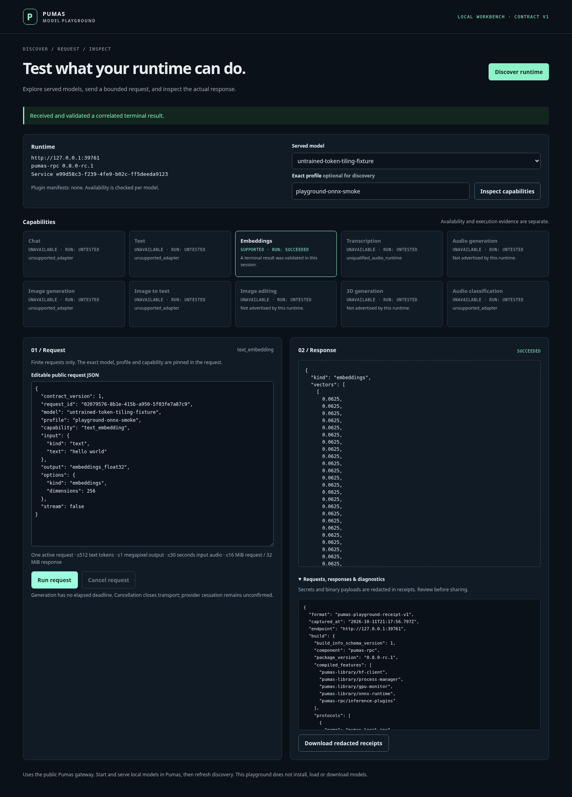

# Pumas Playground

See what your local AI runtime supports, send a request, and inspect the result.

Pumas Playground is a small browser workbench for a running [Pumas Library](https://github.com/MrScripty/Pumas-Library) gateway. Discover served models, inspect their live capabilities, edit a finite request and examine the actual response and redacted HTTP receipts.



*Real ONNX execution with an untrained numerical fixture. [Details](evidence/verification.md).*

## Run

Use Node.js 24, pinned in `.node-version`. No package installation or frontend build is needed:

```bash
git clone https://github.com/MrScripty/Pumas-Playground.git
cd Pumas-Playground
node server.mjs --backend http://127.0.0.1:8080
```

Open `http://127.0.0.1:8787`. Choose the public gateway of an already running, authorized Pumas instance. The playground does not start providers, download models or load/unload them.

The backend address must be numeric loopback HTTP. The Pumas v0.7.0 release alone is insufficient: the gateway needs the public discovery, generation-fencing and typed v1 operation APIs described in the [compatibility evidence](evidence/verification.md).

## Try a request

1. Click **Discover runtime**.
2. Select a served model and, when needed, its exact profile.
3. Click **Inspect capabilities**, choose an available operation and edit the request.
4. Click **Run request**, inspect the response, then explicitly download receipts or generated PNGs if you need them.

Reviewed adapters cover finite chat/text, embeddings, raw-PCM transcription, image generation and image-to-text when the exact runtime advertises support. Unsupported capabilities stay unavailable; the UI does not infer readiness from a model name.

One request runs at a time. Cancellation closes the upstream connection but does not prove provider work stopped. Receipts redact known secrets, but private prose can remain; review exports before sharing.

## Test and extend

```bash
npm test
```

The deterministic tests use local fixtures without models or extra npm packages. [The reference guide](docs/reference.md) covers formats, limits, lifecycle, runtime compatibility, optional browser checks and opt-in real-runtime tests.

[Contributing](CONTRIBUTING.md) · [Verification](evidence/verification.md) · [Standalone provenance](evidence/standalone.md)

[Apache-2.0 License](LICENSE). [NOTICE](NOTICE.md) retains provenance and the upstream MIT notice.

